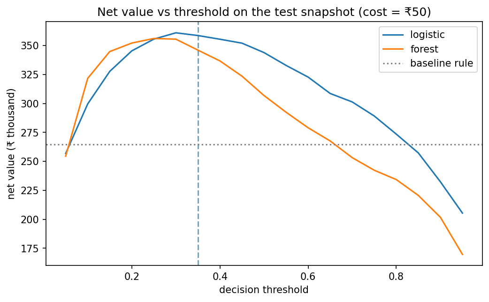

# Broker Client Dormancy Predictor

A lakehouse-style pipeline (Bronze, Silver, Gold on local Parquet) plus a machine learning model that predicts which active broker clients are likely to stop trading in the next 90 days, so a relationship manager (RM) gets a ranked call list.

## 1. Problem and why it matters

A full-service broker earns when clients trade, and RMs can only call so many clients a day. Clients who quietly stop trading are lost revenue that nobody notices until it is too late, and preventing dormancy is cheaper than reversing it. The decision this project supports is: each week, which clients should an RM call first? That is a ranking problem, not a yes/no problem, so success is measured by how many truly at-risk clients the call list contains and at what cost, not by accuracy.

## 2. Architecture

```
Generator -> data/bronze/*.csv   (raw, never edited, load_date + source_file)
          -> data/silver/*.parquet + quality_report.txt + rejected_rows.csv
          -> data/gold/features_<snapshot>.parquet   (DuckDB SQL)
          -> DormancyModel -> results table, threshold, RM call list
```

- **Bronze:** raw CSVs exactly as generated, including deliberately injected dirty rows. Never edited. If a cleaning bug is found, Silver is rebuilt from Bronze.
- **Silver:** typed, deduplicated, validated tables. Bad rows are quarantined in `rejected_rows.csv` with a reason, not silently deleted. Quality checks are written to `quality_report.txt`, and a critical failure raises an error and stops the pipeline.
- **Gold:** one row per at-risk client at a snapshot date, built by `src/features.sql` running on the Silver Parquet files through DuckDB.
- **Model:** logistic regression and random forest, compared with a rule-based baseline.

This is a lakehouse-style medallion pipeline on local files. A production lakehouse would add a table format such as Delta Lake or Iceberg for transactions, schema enforcement and versioning.

## 3. Data

**Real client data is private, so the data is simulated.** The goal is a realistic, learnable pattern, not realistic numbers.

**Tables**

| Table | Columns |
|---|---|
| clients | client_id (PK), signup_date, segment, age_band, city |
| trades | trade_id (PK), client_id (FK), trade_date, product, value |
| logins | login_id (PK), client_id (FK), login_date |

Every Bronze file also carries `load_date` and `source_file` for lineage.

**Simulation parameters**

- 10,000 clients, daily data from 2025-01-01 to 2025-12-31, random seed 42
- Signup dates 1 day to 5 years before 2025-01-01
- Segments: 20% Active (about 8 trades a month), 40% Regular (about 3), 40% Occasional (about 1), each client's rate multiplied by a log-normal factor (sigma 0.3)
- Daily trade counts drawn from a Poisson distribution
- Trade values drawn from a log-normal distribution with a median of Rs 5,000 (sigma 1.0)
- 25% of clients go dormant, with a quit day between roughly March and November. In the 60 days before quitting, their trade rate falls smoothly from 1.0x to 0.1x, and after the quit day it is 0
- Logins are Poisson, tied to the trading rate, with a longer 75-day decay (floor 0.15x), so logins fall earlier than trades
- Noise: 20% of non-quitters get a temporary quiet spell of 20 to 45 days at 15% activity
- About 0.5% dirty trade rows, split evenly across five types: duplicate trade_id, negative value, missing client_id, a different date format (DD/MM/YYYY), and an orphan client_id. A few orphan client_ids are also injected into logins

> Absolute scores are properties of my simulation, not real-world claims. The methodology is what transfers.

## 4. Label, snapshots and the leakage argument

**Population:** only clients with at least one trade in the 90 days before the snapshot. A client who is already dormant is not a prediction problem.

**Label:** `dormant_next_90d = 1` if the client makes zero trades in the 90 days starting at the snapshot.

| | Train | Test |
|---|---|---|
| Snapshot date | 2025-06-01 | 2025-09-01 |
| Feature window | 3 Mar to 31 May | 3 Jun to 31 Aug |
| Label window | 1 Jun to 29 Aug | 1 Sep to 29 Nov |

Why this is leakage-safe:

- Features use only data strictly before the snapshot. The label is the only part of the SQL that looks at data on or after it.
- The training label window ends on 29 Aug, before the test snapshot of 1 Sep, so everything the model learned from was knowable before the test period began.
- The scaler is fitted inside an sklearn Pipeline on training data only.
- The decision threshold is chosen on the train snapshot using out-of-fold predictions and applied once to the test snapshot. The test set is never used for tuning.

The split is by time, not random, because in real life you always predict forward.

## 5. Features

| Feature | Definition |
|---|---|
| trades_30d, trades_60d, trades_90d | Trade counts in each look-back window |
| trade_trend | Trades in the last 30 days minus trades in the 30 days before. Negative means slowing down |
| days_since_last_trade | Days from the last trade to the snapshot |
| avg_trade_value_90d | Mean trade value in the 90-day window |
| distinct_products_90d | Number of different products traded |
| logins_30d | Logins in the last 30 days |
| login_trend | Logins in the last 30 days minus the 30 days before |
| days_since_last_login | Days since last login (capped at 90 if none in the window) |
| tenure_days | Snapshot date minus signup date |
| segment | One-hot encoded in the model step |

Logins use a LEFT JOIN with COALESCE, so clients with no logins stay in the table. Trades use an INNER JOIN because the population is clients who traded.

## 6. Results

Test snapshot (2025-09-01): 8,593 at-risk clients, 1,002 of whom went dormant (11.7%). A useless model would have a PR-AUC of about 0.117.

| Model | Threshold | Precision | Recall | F1 | ROC-AUC | PR-AUC | Net value (Rs) |
|---|---|---|---|---|---|---|---|
| Baseline (> 30 days since last trade) | n/a | 0.337 | 0.585 | 0.428 | n/a | n/a | 264,650 |
| Logistic regression | 0.35 | 0.273 | 0.859 | 0.414 | 0.886 | 0.676 | 358,700 |
| Random forest | 0.35 | 0.305 | 0.792 | 0.440 | 0.883 | 0.671 | 346,100 |

Improvement over the baseline in net value: logistic 35.5%, forest 30.8%, computed as (model net - 264,650) / 264,650.



**Cost model assumptions (assumptions, not facts):** a call costs Rs 50 of RM time, 30% of contacted dormant clients are retained, and a retained client is worth Rs 2,000 in brokerage over the next year. Net value = (true positives x 0.30 x 2,000) - (clients called x 50). Calling a group pays off when its precision exceeds 50 / 600, about 8.3%, so the best threshold favours recall.

**Sensitivity:** if a call costs Rs 500 instead, break-even precision becomes 83% and the chosen threshold rises from 0.35 to a very high value (0.95 for logistic, 0.90 for the forest, at the edge of the sweep range), so far fewer clients are called.

**Findings**

- The two models rank clients almost equally well (ROC-AUC 0.886 vs 0.883, PR-AUC 0.676 vs 0.671). Logistic has about 3.5% higher net value at the chosen threshold, but with one test snapshot this is too small a gap to name a winner.
- Both models beat the rule on net value (+35.5% and +30.8%). The gain comes from higher recall: they catch 79% to 86% of dormant clients against the rule's 58%.
- F1 at the chosen threshold is lower than the baseline's for logistic (0.414 vs 0.428), because the threshold maximises money, not F1. A missed client costs far more than a wasted call.
- Login features lead the random forest importances. This is a property of the simulation (logins decay earlier and have a higher event rate), not a general claim.
- Predicted probabilities are not calibrated (`class_weight="balanced"` inflates them), which is why the best threshold is far above the 8.3% break-even precision.
- The call list (logistic, threshold 0.35) has 3,163 clients, 36.8% of the test population. A real team would cap it by RM capacity.
- Gold output is ordered by `client_id`. Without it, SQL row order varied between runs, which changed the cross-validation folds and moved the chosen threshold.

## 7. How to run

```
git clone <your repo url>
cd client-dormancy-predictor
python -m venv venv
venv\Scripts\activate.bat
pip install -r requirements.txt
python run_all.py
python -m pytest
```

On Mac or Linux, activate with `source venv/bin/activate`. `run_all.py` regenerates all data, runs every layer, trains the models and writes `reports/results.csv`, `reports/threshold_chart.png` and `reports/rm_call_list.csv`. Running it twice gives identical results.

Tests (5): negative values are quarantined, `bronze_to_silver` is idempotent, features are valid and use only pre-snapshot data, the test snapshot is after the train label window, and predicted probabilities lie in [0, 1].

## 8. Limitations and next steps

**Limitations**

- Synthetic data: scores are not real-world claims.
- Cost numbers are assumptions.
- One 90-day horizon and two snapshots only. Real clients have seasonality and market-regime effects.
- Clients who quit abruptly with no preceding slowdown cannot be predicted by behavioural features.
- Local files, not a transactional table format. No monitoring, deployment or fairness review.
- Probabilities are uncalibrated, so they work as risk rankings, not literal probabilities.

**Next steps**

- Gradient boosting and SHAP explanations, so an RM sees why a client is flagged.
- Delta Lake or Iceberg tables for transactions and versioning, and PySpark for scale.
- A FastAPI endpoint, a Docker image and drift monitoring.
- Calibration check and testing 60 and 180 day horizons.
- Real features (market conditions, product holdings, funds added), validated on real data under proper approvals and a SEBI-aware review.